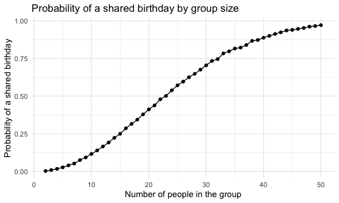
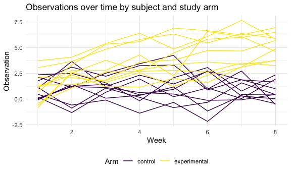
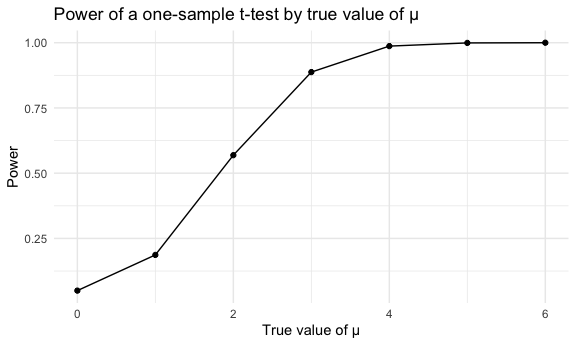
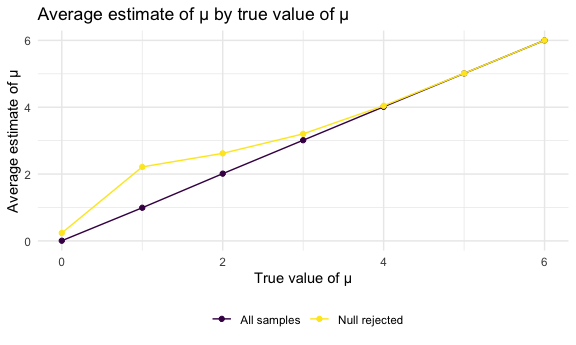

Homework 5
================

# Problem 1

The function `birthday_repeated()`, found in
`source/birthday_repeated.R`, draws a birthday for each person in a
group of a given size and returns `TRUE` if at least two people share a
birthday.

``` r
source("source/birthday_repeated.R")

birthday_results_df = 
  expand_grid(
    number_of_people = 2:50,
    iter = 1:10000
  ) |> 
  mutate(
    repeated = map_lgl(number_of_people, birthday_repeated)
  )

birthday_results_df |> 
  group_by(number_of_people) |> 
  summarize(
    prob_of_repeat = mean(repeated)
  ) |> 
  ggplot(aes(x = number_of_people, y = prob_of_repeat)) + 
  geom_line() + 
  geom_point() +
  labs(
    title = "Probability of a shared birthday by group size",
    x = "Number of people in the group",
    y = "Probability of a shared birthday"
  )
```



The probability that at least two people share a birthday increases
quickly with group size, and plateaus near 1. It passes 0.5 at a group
size of roughly 23.

# Problem 2

``` r
study_df = 
  tibble(file = list.files("data/")) |> 
  mutate(
    path = str_c("data/", file),
    data = map(path, read_csv)
  ) |> 
  unnest(data) |> 
  separate(file, into = c("arm", "subject_id"), sep = "_") |> 
  mutate(
    subject_id = str_remove(subject_id, "\\.csv"),
    arm = case_match(arm, "con" ~ "control", "exp" ~ "experimental")
  ) |> 
  pivot_longer(
    starts_with("week"),
    names_to = "week",
    names_prefix = "week_",
    values_to = "observation"
  ) |> 
  mutate(week = as.numeric(week)) |> 
  select(-path)
```

    ## Warning: There was 1 warning in `mutate()`.
    ## ℹ In argument: `arm = case_match(arm, "con" ~ "control", "exp" ~
    ##   "experimental")`.
    ## Caused by warning:
    ## ! `case_match()` was deprecated in dplyr 1.2.0.
    ## ℹ Please use `recode_values()` instead.

``` r
study_df |> 
  ggplot(aes(x = week, y = observation, group = str_c(arm, subject_id), color = arm)) +
  geom_line() +
  labs(
    title = "Observations over time by subject and study arm",
    x = "Week",
    y = "Observation",
    color = "Arm"
  )
```



At week 1, the two arms have similar, overlapping values. Over the 8
weeks, observations in the experimental arm trend upward, while
observations in the control arm stay roughly constant. By the end of the
study, nearly every experimental subject has a higher value than the
control subjects. Within each arm, individual subjects fluctuate
considerably from week to week.

# Problem 3

The function for calculating the power of a 1-sample t-test with fixed
n=30 and $\sigma$ = 5, `pwr_1sampt`, is found in `source/pwr_1sampt.R`.

``` r
source("source/pwr_1sampt.R")

sim_results_df = 
  expand_grid(
    true_mu = 0:6,
    iter = 1:5000
  ) |> 
  mutate(results = map(true_mu, pwr_1sampt)) |> 
  unnest(results)

sim_results_df |> 
  group_by(true_mu) |> 
  summarize(
    power = mean(p_value < 0.05),
    avg_mu_hat = mean(mu_hat),
    avg_mu_hat_rejected = mean(mu_hat[p_value < 0.05])
  ) |> 
  knitr::kable(digits=3)
```

| true_mu | power | avg_mu_hat | avg_mu_hat_rejected |
|--------:|------:|-----------:|--------------------:|
|       0 | 0.050 |      0.005 |               0.236 |
|       1 | 0.187 |      0.992 |               2.214 |
|       2 | 0.569 |      2.012 |               2.620 |
|       3 | 0.887 |      3.013 |               3.203 |
|       4 | 0.987 |      4.013 |               4.043 |
|       5 | 0.999 |      5.011 |               5.013 |
|       6 | 1.000 |      6.001 |               6.001 |

``` r
sim_results_df |> 
  group_by(true_mu) |> 
  summarize(
    power = mean(p_value < 0.05)
  ) |> 
  ggplot(aes(x = true_mu, y = power)) +
  geom_point()+
  geom_line() +
  labs(
    title = "Power of a one-sample t-test by true value of μ",
    x = "True value of μ",
    y = "Power"
  )
```



Power increases with effect size, following an S-shaped curve. At μ = 0,
the null is true, so the rejection rate is about 0.05, which is the type
I error rate α rather than power. Power is low at μ = 1, rises steeply
to about 0.5 at μ = 2, and is essentially 1 from μ = 4 onward. Since
power is a probability, it plateaus as it approaches 1.

``` r
sim_results_df |> 
  group_by(true_mu) |> 
  summarize(
    all_samples = mean(mu_hat),
    null_rejected = mean(mu_hat[p_value < 0.05])
  ) |> 
  ggplot(aes(x = true_mu)) +
  geom_point(aes(y = all_samples, color = "All samples")) +
  geom_line(aes(y = all_samples, color = "All samples")) +
  geom_point(aes(y = null_rejected, color = "Null rejected")) +
  geom_line(aes(y = null_rejected, color = "Null rejected")) +
  labs(
    title = "Average estimate of μ by true value of μ",
    x = "True value of μ",
    y = "Average estimate of μ",
    color = ""
  )
```



Across all samples, the average $\hat{\mu}$ is approximately equal to
the true μ at every value, because the sample mean is an unbiased
estimator of μ.

Among only the samples where the null was rejected, the average
$\hat{\mu}$ is not approximately equal to the true μ when μ is small. At
μ = 1 and μ = 2 it is noticeably larger than the true value, and at μ =
3 it is slightly larger. From μ = 4 onward, the two lines overlap.

This happens because the null is only rejected when $\hat{\mu}$ is far
enough from 0. When the true μ is small and power is low, the samples
that reach significance are disproportionately those that overestimated
μ, so their average is biased upward. As μ increases, power approaches
1, nearly every sample is rejected, and the average among rejected
samples converges to the true value.
